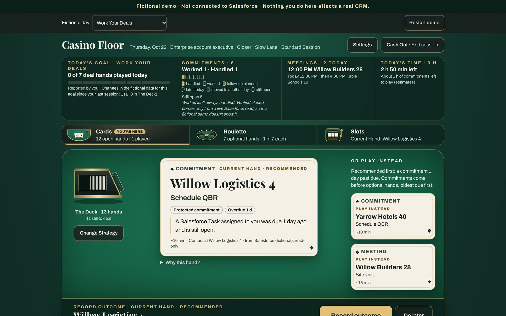
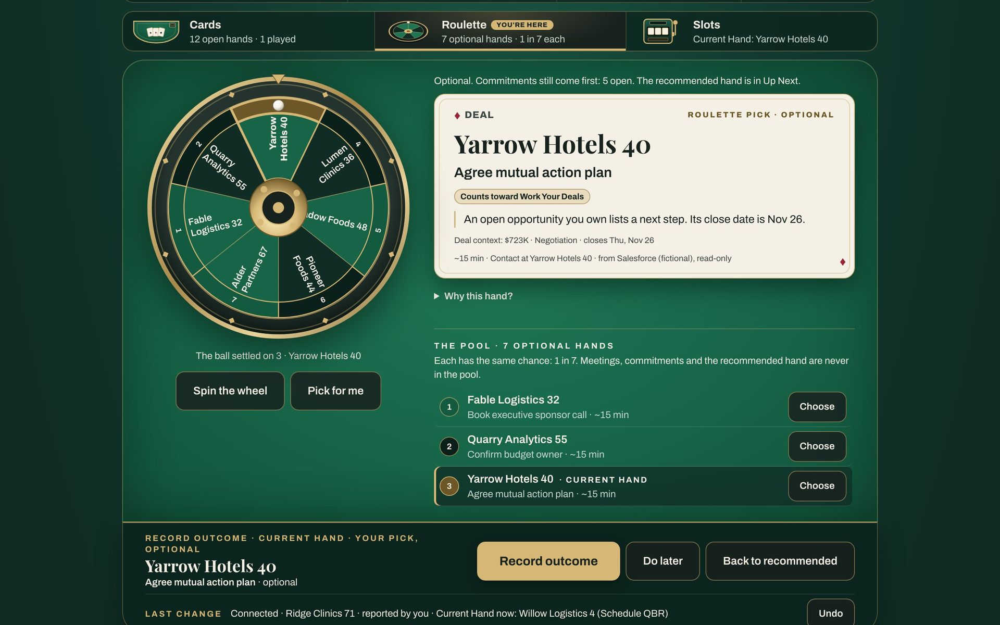
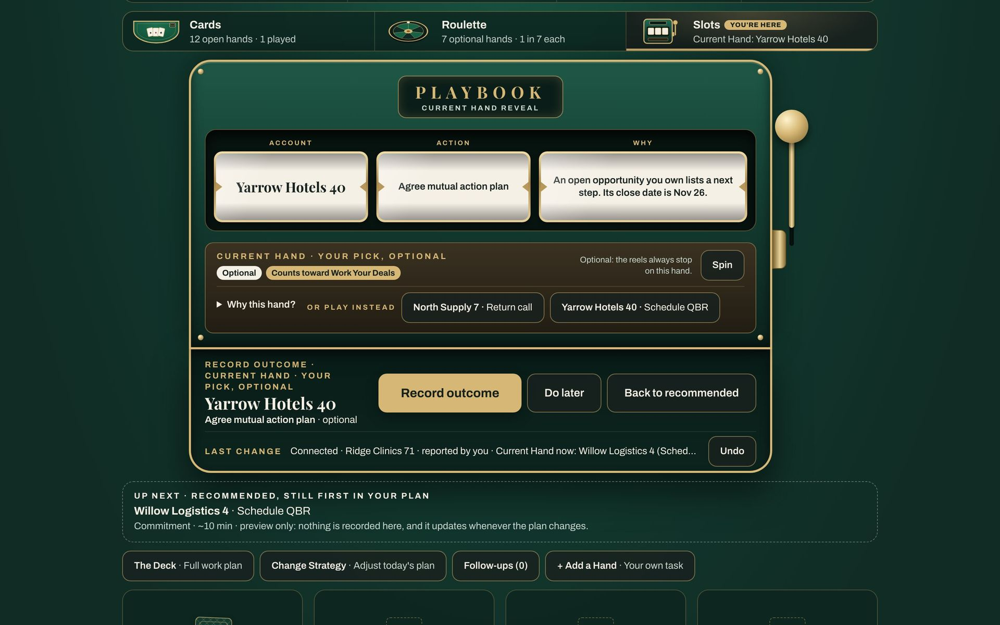
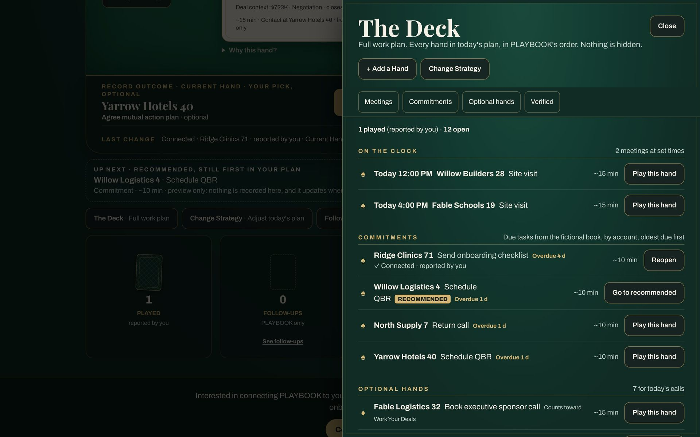
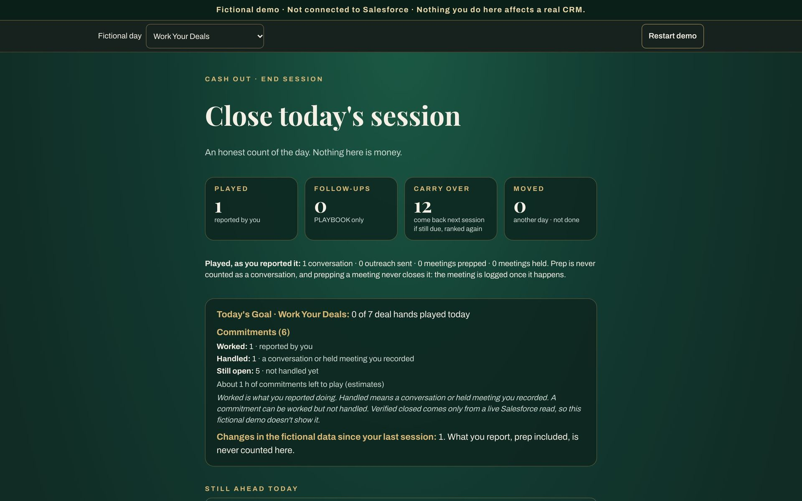

# PLAYBOOK

**Turn your Salesforce pipeline into a game worth playing.**

PLAYBOOK is a casino-inspired sales productivity application built to integrate with Salesforce. It
turns a rep's accounts, opportunities, tasks and meetings into a prioritized day of plays, then keeps
an honest record of what was worked, what was handled and what follow-up was planned.

**[Try the interactive demo →](https://playbook-casino-demo.pages.dev)**

The demo is fully interactive and runs in your browser. Every account, deal and task in it is
fictional. It needs no Salesforce connection and no account or sign-in, and you can restart the
simulated day at any time.

---

## Why PLAYBOOK

A salesperson's day is spread across opportunities, follow-ups, meetings, overdue tasks and the
promises made to customers. A CRM organizes that information well, but deciding what to do next,
and keeping track of whether it got done, is still left to the rep.

PLAYBOOK is designed around five everyday problems:

- **Daily prioritization.** Commitments that are due come first, oldest first, and optional work
  fills the time that's left. Every recommendation says why it comes first.
- **Opportunity engagement.** Deals with a next step, a slipping close date or no recent activity
  surface as plays, with their context alongside.
- **Follow-up commitments.** Protected obligations are never hidden or silently dropped, even on an
  overloaded day. Follow-ups and "do later" choices are tracked rather than forgotten.
- **Workflow organization.** The whole day is one plan, worked one hand at a time, with the full
  plan always one step away.
- **Activity accountability.** Reported work, handled commitments and Salesforce-verified closures
  are counted separately and never blurred together.

The casino layer makes planning and execution engaging without changing the work itself. There are
no leaderboards, fake currencies or rewards for empty activity.

## The experience

| Stage              | What happens                                                                                                                       |
| ------------------ | ---------------------------------------------------------------------------------------------------------------------------------- |
| **Buy-In**         | Four quick calls set the day's strategy: your approach, what's in the way, the time you have and today's goal.                     |
| **Casino Floor**   | The Current Hand (the recommended next play) with its reason, plus the day's goal, commitments, meetings and remaining time.       |
| **Cards**          | Work the plan in order, dealt from the shoe. Recorded hands land in honest piles: played, follow-ups, later today and moved.       |
| **Roulette**       | An optional pick from a visible pool of optional hands, each with an equal chance. Commitments and meetings are never in the pool. |
| **Slots**          | The reels reveal the Current Hand: account, action and why. They always stop on the real hand, and spinning is optional.           |
| **Record Outcome** | Connected, outreach sent, follow-up needed or no action taken. Meetings and meeting prep have their own outcomes.                  |
| **The Deck**       | The full work plan: meetings, commitments, optional hands, deal context and what changed since the last session.                   |
| **Cash Out**       | An end-of-day summary: what was played, follow-ups set, commitment accounting and what carries over.                               |

Cards, Roulette and Slots are three ways to work **the same plan**: switching games never changes the
work or the counts. The [demo walkthrough](docs/DEMO_WALKTHROUGH.md) covers every stage step by step.

  
  

  
  

## Honest commitment accounting

Each measure is reported on its own, because they overlap and are not complementary:

| Measure               | Meaning                                                                                      |
| --------------------- | -------------------------------------------------------------------------------------------- |
| **Worked**            | A conversation, outreach or held meeting was reported.                                       |
| **Handled**           | A conversation or held meeting was recorded in context, or Salesforce shows the task closed. |
| **Verified closed**   | Salesforce's own task record shows it closed.                                                |
| **Still open**        | Not handled yet.                                                                             |
| **Follow-up planned** | A follow-up was set: a plan, not a result.                                                   |

Verified closed comes only from real Salesforce records. The public demo has none, so it never shows
a verified count and says so on screen.

## Two environments

|                       | Connected application                         | Public demo                                      |
| --------------------- | --------------------------------------------- | ------------------------------------------------ |
| Data                  | The user's own Salesforce records (read-only) | Fictional scenarios built into the demo          |
| Sign-in               | Required                                      | None                                             |
| Storage               | PostgreSQL, scoped to each user's workspace   | The browser tab only                             |
| Salesforce connection | OAuth, server-side, read-only                 | None                                             |
| Availability          | Private                                       | [Public](https://playbook-casino-demo.pages.dev) |

Both use the same casino interface and the same planning and accounting rules. The public demo is
a static build of that interface with fictional data. It makes no Salesforce, API or database
requests. Details: [architecture overview](docs/ARCHITECTURE_OVERVIEW.md).

## Technology

- **Connected application:** Next.js (App Router), React and TypeScript; Clerk authentication;
  PostgreSQL with Prisma; Salesforce REST API through OAuth 2.0 with PKCE (read-only).
- **Public demo:** a Next.js static export of the same casino interface, hosted on Cloudflare Pages.
- **Testing:** Vitest, Testing Library, axe accessibility checks and Playwright.

## Salesforce integration

**Built to integrate with Salesforce.** The connected application reads a user's own accounts,
contacts, opportunities, tasks and meetings through Salesforce's API, with read-only access and
minimal permissions. It never writes to Salesforce.

The integration has been validated against a Salesforce Developer Edition organization using
fictional data. It is not Salesforce-certified, not listed on AppExchange and not endorsed by
Salesforce, and it is not yet deployed with production customers. Connecting a real organization is
a private process that includes compatibility testing, a security review and approved onboarding.
Details: [Salesforce integration](docs/SALESFORCE_INTEGRATION.md).

## Engineering

- **Automated testing at several levels.** Unit and component tests, integration tests against a real
  PostgreSQL database, and end-to-end browser tests of the full casino journey.
- **Continuous integration** runs these suites on every pull request and main-branch change, with a
  separate job that builds, scans and browser-tests the public demo.
- **Tenant isolation** in the connected application: every request is scoped to the signed-in user's
  workspace on the server, and other workspaces' records are never returned.
- **Secure credential handling:** Salesforce credentials stay on the server and are encrypted at rest.
- **Read-only Salesforce integration**, with a guard against write operations.
- **Static demo isolation:** the public demo has no backend, database, sign-in or Salesforce
  connection, and its build output is scanned for credentials and server endpoints before
  publication.

More: [security and privacy](docs/SECURITY_AND_PRIVACY.md).

## About this repository

- The interactive demo at [playbook-casino-demo.pages.dev](https://playbook-casino-demo.pages.dev) is
  publicly accessible.
- The connected application's source code is private.
- This repository contains public documentation and selected screenshots of the fictional demo.

## Contact

Interested in connecting PLAYBOOK to your Salesforce organization? Let's discuss private onboarding.

**[Contact](https://www.linkedin.com/in/bodhiparks/)**

## Copyright

© 2026 Bodhi Parks. All rights reserved.

This repository's documentation and screenshots are published for reference. No open-source license
is granted. The connected application's source code is maintained privately and is not included.
