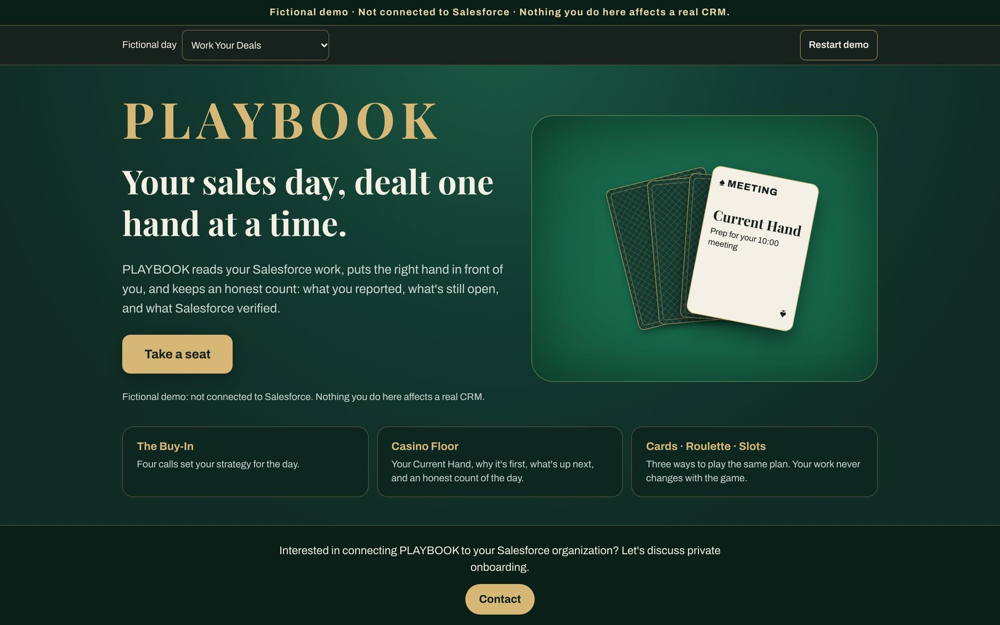
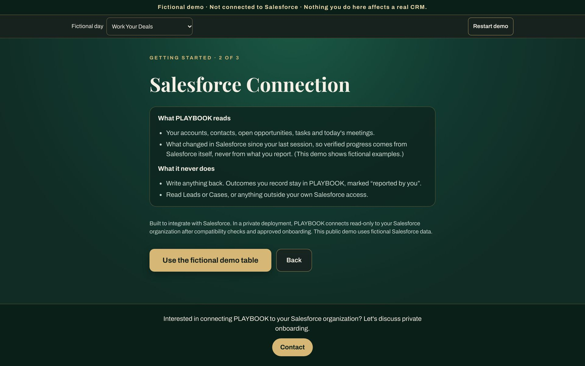
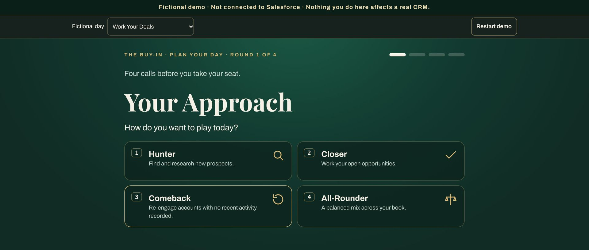
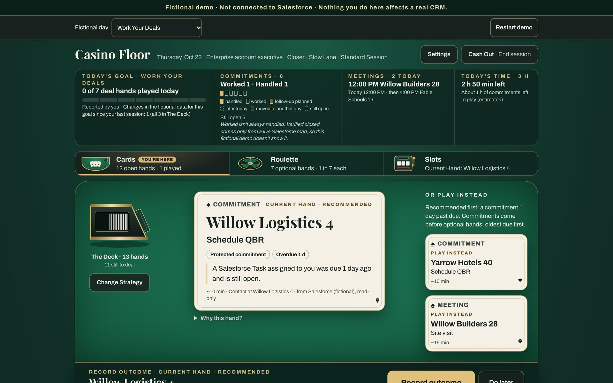
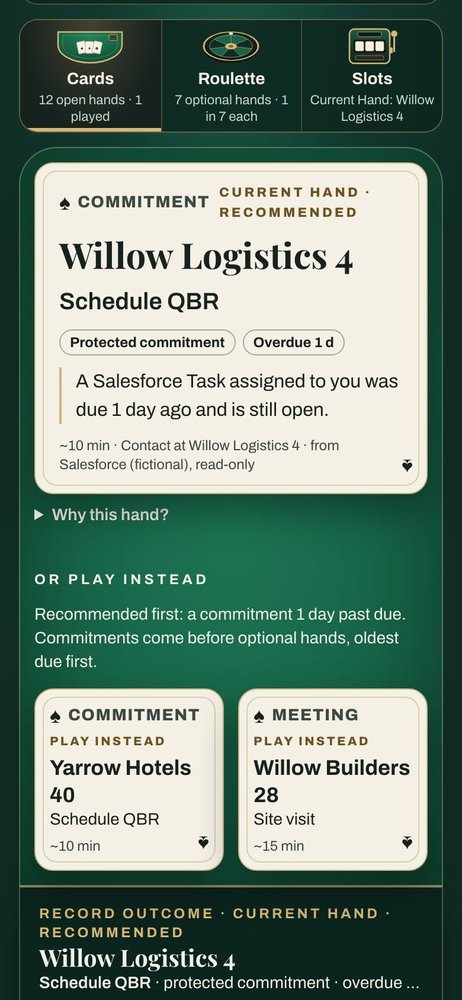
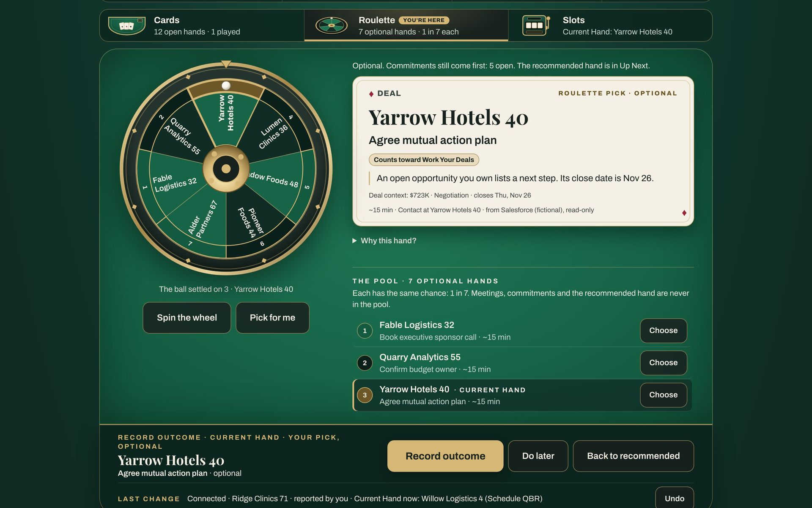
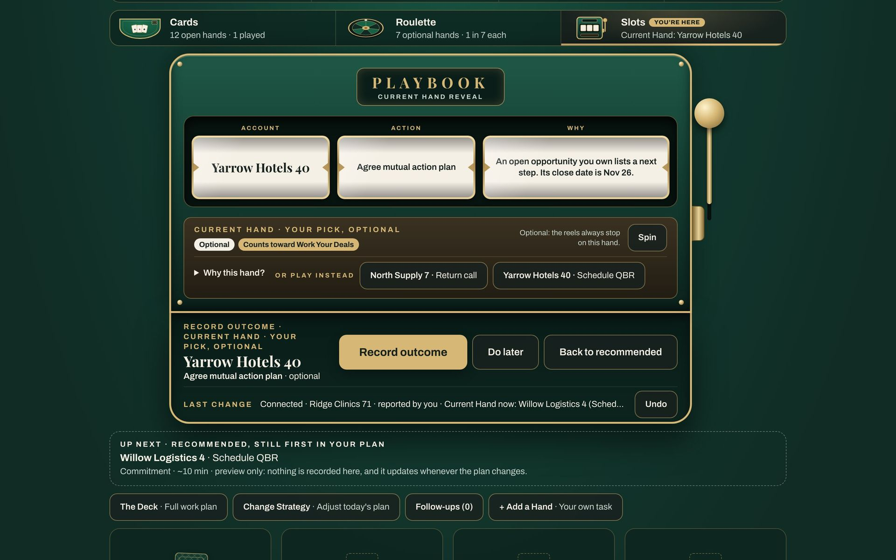
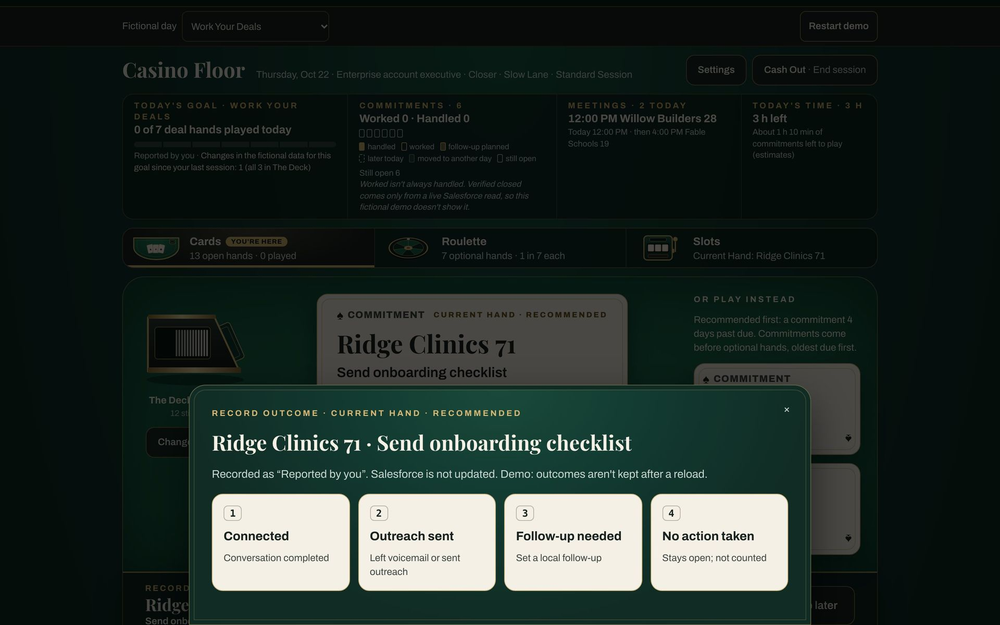
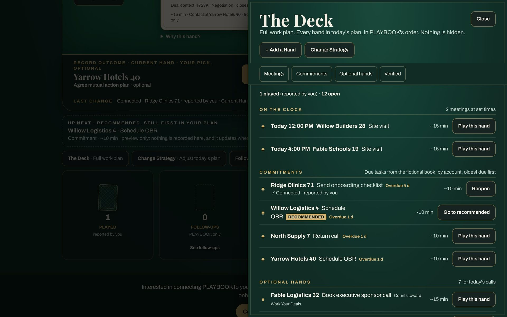
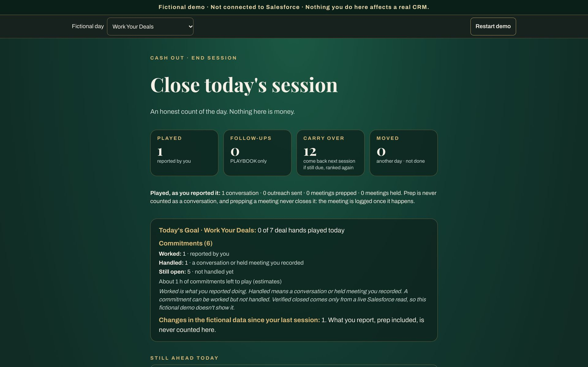

# PLAYBOOK — Interactive Demo Walkthrough

**Experience a sales day on the casino floor.**

This guide walks through one complete fictional sales day in the public demo, from the first screen
to closing the session. No Salesforce knowledge is needed.

**Open the demo:** [playbook-casino-demo.pages.dev](https://playbook-casino-demo.pages.dev)

---

## Before you start

- **No sign-in.** The demo opens straight onto the welcome screen.
- **No Salesforce connection.** Every account, opportunity, task and meeting is fictional. The banner
  at the top of every page says so.
- **Outcomes are simulated.** What you record stays in your browser tab. Nothing is sent anywhere,
  and nothing affects a real CRM.
- **Six fictional days.** The **Fictional day** menu at the top switches between scenarios:
  _Work Your Deals_, _Build Momentum_, _Clear the Table (overloaded)_, _Make a Comeback_,
  _Make a Comeback (no room)_ and _Meeting-heavy (overloaded)_.
- **Restart at any time.** **Restart demo** (top right) clears your progress and deals the day again.
- **Keyboard friendly.** Number keys pick answers and outcomes, and the demo respects your device's
  reduced-motion setting.

## 1. Take a seat

Select **Take a seat**. Three quick questions describe the fictional rep: their role, their usual
outreach rhythm and what most of their days look like.

Next, the **Salesforce Connection** step explains what the connected product reads and what it never
does. In a private deployment, PLAYBOOK connects read-only to a Salesforce organization after
compatibility checks and approved onboarding. In the demo there is nothing to connect: select **Use
the fictional demo table**.

**Your table is ready** then summarizes the fictional day, including today's meetings, the
commitments due and the open deals. Select **Go to The Buy-In**.

## 2. The Buy-In

The Buy-In sets the strategy for the day in four rounds. Choose with the mouse or the number keys
1–4.

| Round                 | Choices                                                                                        |
| --------------------- | ---------------------------------------------------------------------------------------------- |
| **Your Approach**     | Hunter · Closer · Comeback · All-Rounder                                                       |
| **What's in the Way** | Radio Silence · Backlog · Slow Lane · Clear Skies                                              |
| **Your Time**         | Short Session (about 1 hour) · Standard Session (about 3 hours) · Long Session (about 6 hours) |
| **Today's Goal**      | Work Your Deals · Make a Comeback · Clear the Table · Build Momentum                           |

**Review your calls** lets you change any answer. If a choice would leave the goal with nothing to
work on, the Buy-In says so before you start. Select **Deal my table**.

## 3. The Casino Floor

The floor is where the day is worked.

- **The status rail** shows **Today's Goal** and progress toward it, **Commitments** (with the honest
  accounting described below), today's **Meetings**, and **Today's Time** left.
- **The game selector** switches between **Cards**, **Roulette** and **Slots**. All three work the
  same plan, so switching never changes the work or the counts.
- **The Current Hand** is the play to work now. When it's the recommendation, the card says
  "recommended" and explains why it comes first, for example "a commitment 1 day past due".
  **Why this hand?** shows the full reasoning.
- **Record outcome** sits under the game, with **Do later** beside it. **Up Next** previews what
  comes after the current hand.
- **The controls** open **The Deck**, **Change Strategy** (rebuild today's plan with different
  calls), **Follow-ups**, and **Add a Hand** for work of your own.

Commitments always come before optional work, oldest due first, and they are never hidden.

The floor works the same way on a phone:

## 4. Cards

Cards deals the plan in order. The **Current Hand** sits in the centre with the shoe (**The Deck**)
beside it. Under **Or play instead**, the next hands in the plan let you take a different hand
without losing the recommendation.

To work a hand, select **Record outcome**. Each recorded hand moves to an honest pile at the bottom
of the floor: **Played**, **Follow-ups**, **Later today** or **Moved**. **Undo** reverses the last
change.

## 5. Roulette

Roulette adds variety to optional work without ever replacing what's due.

- **The pool** lists the day's optional hands, and each has the same chance. Meetings, commitments
  and the recommended hand are never in the pool.
- **Spin the wheel** picks one at random in your browser. **Pick for me** picks one without the
  animation, and **Choose** takes a specific hand.
- The pick becomes the **Current Hand**, labelled optional. The recommended hand keeps its place in
  **Up Next**, and **Back to recommended** returns to it.

## 6. Slots

Slots reveals the Current Hand on three reels: **Account**, **Action** and **Why**. The reels always
stop on the real Current Hand. Slots is a briefing, not a game of chance.

The reels wait face down until you pull the lever or select **Spin**. After each outcome they reset,
so every new hand is revealed by your next pull. You can still record an outcome straight away;
Record Outcome names the hand. Record the outcome below the machine, as in Cards.

## 7. Record Outcome

**Record outcome** opens a sheet naming the account and the action. For an ordinary play the choices
are:

| Key | Outcome              | What it means                                                   |
| --- | -------------------- | --------------------------------------------------------------- |
| 1   | **Connected**        | A conversation took place.                                      |
| 2   | **Outreach sent**    | A voicemail or message was sent.                                |
| 3   | **Follow-up needed** | Set a follow-up date, or none yet. It stays a plan in PLAYBOOK. |
| 4   | **No action taken**  | Recorded, but the hand stays open and isn't counted.            |

Meetings have their own choices. Before a meeting starts, you can report prep or outreach, and the
meeting stays open until it's held. The demo's clock is fixed at the start of the fictional day, so
the day's meetings can be prepared but not yet held.

Every outcome is marked "reported by you". The status rail updates straight away, and the
confirmation names the next Current Hand.

### How the commitments count updates

The **Commitments** panel uses honest commitment accounting:

- **Worked**: you reported a conversation, outreach or a held meeting.
- **Handled**: a conversation or held meeting you recorded.
- **Still open**: not handled yet.
- **Follow-up planned**: a follow-up you set (a plan, not a result).

Outreach counts as worked but not handled; a conversation counts as both. In the connected product,
a fifth measure, **Verified closed**, counts tasks that Salesforce itself shows closed. The demo has
no Salesforce, so it never shows a verified count, and a note on the floor and at Cash Out explains
why.

## 8. The Deck

**The Deck** opens the full work plan, so nothing is hidden. Jump links take you to each section.

- **On the clock**: today's meetings at their set times.
- **Commitments**: due tasks from the fictional book, by account, oldest due first. Worked hands
  show what was recorded, with **Reopen** to change it.
- **Optional hands**: the rest of the plan, in PLAYBOOK's order.
- **Bonus Hand** and **Mystery Card**: optional extras you can take or leave.
- **Deal Intel**: deal context from the fictional book, for information only.
- **Changes in the fictional data since your last session**: what changed between the fictional
  "yesterday" and "today", such as new tasks, a deal closed won or a task closed. These are changes
  in scenario data, not live Salesforce observations.

**Play this hand** makes any hand current. **+ Add a Hand** and **Change Strategy** are also here.

## 9. Cash Out

Select **Cash Out** at the top of the floor to review the day.

- **Played**, **Follow-ups**, **Carry over** and **Moved**: what was done, what was planned, what
  comes back next session and what moved to another day.
- **Played, as you reported it**: conversations, outreach, meetings prepped and meetings held.
- **Today's Goal** and the **Commitments** panel: Worked, Handled, Still open and Follow-up planned,
  with a plain explanation of each.
- **Still ahead today** and **Carrying over**: the work that remains.

Select **Close the session** to finish. **Session closed** summarizes the day and offers **Back to
the Casino Floor** or **Back to the start**.

## 10. Restart and explore

- **Restart demo** (top right, on every screen) or **Back to the start** clears this tab's progress
  and returns to the welcome screen with a fresh day.
- **Fictional day** switches to another scenario. The overloaded days show how PLAYBOOK keeps
  commitments visible when there isn't time for everything.
- Each browser tab is independent: a new tab, window or browser always starts a fresh day.

Nothing in the demo affects a real Salesforce organization.

---

**Interested in connecting PLAYBOOK to your Salesforce organization?** Let's discuss private
onboarding: [Contact](https://www.linkedin.com/in/bodhiparks/).
